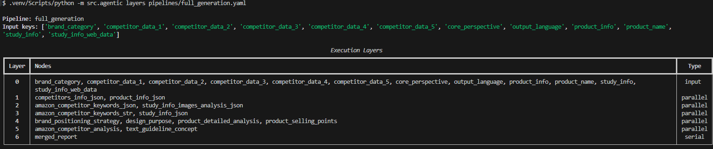
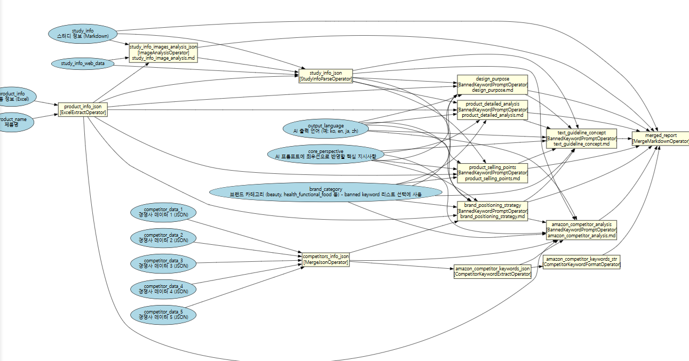

# Agent Builder Framework

A lightweight Python framework for building production AI pipelines as **declarative DAGs** — with automatic dependency resolution, layer-based parallelization, and pluggable LLM operators.

Built to let a small team deploy and maintain multiple enterprise automation systems simultaneously.

> **Who built what.** The problem framing and the framework design (declarative YAML nodes, computed layers, operator/orchestration split) were mine — **MinChan Lee**. The first implementation was written by **Jeonggon Kim** ([SOL — Start of Legend](https://github.com/SOL-Start-of-Legend)), and he is credited as co-author of this repository's commit. Both of us ran it across the client pipelines described below.

**Where to look first:** [`runtime/graph.py`](src/agentic/runtime/graph.py) (flattening + Kahn layering + cycle detection) → [`runtime/executor.py`](src/agentic/runtime/executor.py) (layer-parallel execution, context scoping) → [`operators/generic_prompt.py`](src/agentic/operators/generic_prompt.py) (render → LLM → parse → validate, with retries).

---

## Why This Exists

Multi-step LLM pipelines have a structural problem: each step produces an intermediate output that becomes the input for one or more downstream steps. As pipelines grow, you end up with a web of inputs, intermediate results, and final outputs — and keeping track of what depends on what, what can run in parallel, and what needs to wait becomes genuinely difficult to manage in plain code.

The naive solution is a sequential script. But that throws away parallelism, buries dependencies in execution order rather than making them explicit, and forces every new step to be manually wired into the flow.

When managing six concurrent client automations, this problem was compounded: orchestration logic (dependency tracking, context passing, LLM retries, logging) was duplicated across services while the actual business logic was buried inside it.

This framework makes the dependency graph explicit and handles the rest automatically:

- **Inputs and intermediate outputs** are tracked in a shared context — each node declares what it `produces` and what it `deps` on
- **Execution order** is computed from the dependency graph, not hardcoded
- **Parallelism** is automatic — nodes with no shared dependencies run concurrently
- **Business logic** lives in individual `Operator` classes, separate from orchestration

The result: adding a new processing step means declaring its dependencies in YAML and writing one Python class. The scheduler figures out where it fits.

This also matters for ongoing maintenance. In a forward-deployed context, non-technical operators frequently request changes — "add this analysis step", "change how this output is formatted", "skip this node for certain inputs". With pipeline structure in YAML and logic isolated in individual operators, those requests translate to small, contained edits rather than untangling a monolithic script.

---

## How It Works

### 1. Define nodes in YAML

Each node declares what it produces and what it depends on:

```yaml
# src/agentic/nodes/process/keyword_analyzer.yaml
id: keyword_analyzer
produces: keyword_analysis
kind: process
deps:
  - product_info       # waits for this node
  - competitor_data    # and this node
operator: GenericPromptOperator
prompt_template: "prompts/keyword_analyzer.md"
context_scope: "deps_only"
```

### 2. Declare the pipeline

```yaml
# pipelines/text_generation.yaml
name: "text_generation"
node_dir: "src/agentic/nodes"
nodes:
  - "input/product_info"
  - "input/competitor_data"
  - "process/product_extractor"
  - "process/keyword_analyzer"
  - "process/title_generator"
  - "process/bullets_generator"
```

### 3. The engine handles the rest

```python
from agentic import run_pipeline

result = run_pipeline(
    "pipelines/text_generation.yaml",
    inputs={"product_info": {...}, "competitor_data": {...}},
)
print(result.outputs_only())
```

---

## DAG Execution Engine

The core of the framework is a **topological scheduler** built on Kahn's algorithm.

### Dependency → Layer computation

Given the node graph above, the engine computes execution layers:

```
Layer 0  │  product_extractor    competitor_analyzer   ← independent, run concurrently
Layer 1  │  keyword_analyzer                           ← depends on Layer 0
Layer 2  │  title_generator      bullets_generator     ← independent, run concurrently
```

Nodes in the same layer run via `asyncio.gather()`. No manual parallelization needed.

### Cycle detection at startup

If a dependency cycle exists, the engine raises `ValueError` before any LLM call is made — not mid-execution.

---

## DAG Visualization

**`agentic layers pipelines/full_generation.yaml`** *(29-node Amazon product listing thumbnail guideline generation pipeline)*



**DAG graph (`agentic graph` → Graphviz)**



---

## Architecture

```
src/agentic/
├── api.py                  # run_pipeline() / arun_pipeline() — public entry points
├── models.py               # NodeSpec, FlatNode, PipelineSpec, PipelineResult
├── schemas.py              # Output schema registry (Pydantic models)
├── cli.py                  # CLI (run / layers / graph / node show)
├── llm/
│   ├── base.py             # BaseLLMClient — abstract interface
│   ├── gemini.py           # GeminiClient — multimodal, JSON mode, 429 retry
│   ├── openai.py           # OpenAIClient — multimodal, JSON mode, 429 retry
│   └── mock.py             # MockLLMClient — zero-cost testing
├── operators/
│   ├── base.py             # BaseOperator — abstract interface + VERSION
│   └── generic_prompt.py   # GenericPromptOperator — render → LLM → parse → validate
├── runtime/
│   ├── graph.py            # DAG construction + Kahn's topological sort
│   ├── registry.py         # Operator registration
│   └── executor.py         # Async layer-by-layer execution engine
└── nodes/
    ├── input/              # Input node definitions (.yaml)
    └── process/            # Process node definitions (.yaml)
```

### Execution flow

```
run_pipeline(pipeline_yaml, inputs)
        │
        ├─ Load pipeline + node specs (YAML)
        ├─ Flatten composite nodes (steps → FlatNodes)
        ├─ Compute layers via Kahn's algorithm
        │
        └─ For each layer:
               asyncio.gather(
                   _execute_node(node_A),   ─── resolve context
                   _execute_node(node_B),   ─── render Jinja2 prompt
                   _execute_node(node_C),   ─── call LLM / run operator
               )                            ─── validate output schema
               → merge results into shared context
```

---

## Key Components

### Operators — pluggable business logic

Every node runs through an `Operator`. The default is `GenericPromptOperator`:

```python
class GenericPromptOperator(BaseOperator):
    VERSION = "1.2"

    async def execute(
        self,
        rendered_prompt: str,
        output_schema: type[BaseModel] | None = None,
        context: dict[str, Any] | None = None,
    ) -> dict[str, Any]:
        response = await self.llm_client.generate(rendered_prompt)
        return self._parse_and_validate(response, output_schema)
        # retries up to 4x on JSON parse failure
```

Custom operators extend `BaseOperator` and override `execute()`. Register with one line:

```python
from agentic.runtime.registry import register_operator
register_operator("MyOperator", MyOperator)
```

### Prompt templating with Jinja2

Prompts are `.md` files with full Jinja2 support. The engine injects resolved node outputs as template variables:

```jinja2
You are an Amazon listing specialist.

Product: {{ product_info.name }}
Top keywords: {{ keyword_analysis.top_keywords | join(', ') }}
Competitor gap: {{ keyword_analysis.competitor_gap }}

Generate a title under 200 characters that includes the top 3 keywords.
```

`context_scope` controls what's injected:
- `deps_only` — only direct dependencies (default, predictable)
- `all_previous` — all completed node outputs

### Composite nodes (multi-step)

A single node can expand into an internal sub-pipeline:

```yaml
id: analysis
produces: analysis
deps: [raw_data]
steps:
  - id: preprocess
    produces: preprocessed
    deps: [raw_data]
    operator: GenericPromptOperator
    prompt_template: "prompts/preprocess.md"
  - id: analyze
    produces: analysis
    deps: [preprocessed]
    operator: GenericPromptOperator
    prompt_template: "prompts/analyze.md"
```

Steps are flattened into the DAG before scheduling — they participate in the same parallelization as top-level nodes.

### Static config injection

Files in `config/` are auto-loaded and injected into all template contexts without explicit `deps`:

```
config/
  settings.json   → {{ settings.output_language }}
  taxonomy.json   → {{ taxonomy.categories }}
```

Runtime inputs take precedence over config on key collision.

---

## Design Decisions

**Why YAML over code-defined pipelines?**
Node definitions are independently inspectable (`agentic node show keyword_analyzer`) without loading the full runtime. Engineers onboarding to a client's pipeline can read what each step does before touching Python.

**Why Kahn's algorithm over manual layer assignment?**
Cycle detection happens at startup. New nodes are automatically placed in the correct layer — no engineer needs to think about scheduling when adding a step.

**Why layer-level parallelism instead of full graph scheduling?**
`asyncio.gather` per layer is simple to trace when debugging a failed LLM call. You always know exactly which nodes were running simultaneously. Full graph scheduling would be faster in theory but harder to reason about in production.

**Why embed the framework per-service instead of a shared package?**
Each deployed service evolves its operators independently. The core runtime (graph + executor, ~600 LOC) rarely changes; operator logic changes frequently. A shared library would require versioning coordination across 6+ production services with no meaningful benefit.

---

## CLI

```bash
# Run a pipeline end-to-end (real LLM)
agentic run pipelines/example.yaml --inputs inputs.json

# Dry-run with mock LLM — no API cost, tests pipeline structure
agentic run pipelines/example.yaml --inputs inputs.json --llm mock

# Inspect execution layers
agentic layers pipelines/example.yaml

# Generate DAG visualization (requires Graphviz)
agentic graph pipelines/example.yaml | dot -Tpng -o dag.png

# Inspect a single node
agentic node show keyword_analyzer
```

---

## Production Usage

This framework powered **6 enterprise automation systems** in production over 8 months, across two categories of pipelines:

**Multi-source research → structured output**
Pipelines that pull data from external APIs (e-commerce APIs, web scraping), run parallel LLM analysis passes, then assemble a final structured artifact. Node counts ranged from 6–29. External integrations included product data APIs, Playwright-based web scrapers, and cloud storage.

**Document generation with feedback loops**
Pipelines where early nodes extract and classify content, mid-layer nodes generate drafts in parallel, and a final node assembles and validates the combined output. Some pipelines used composite nodes (multi-step sub-pipelines within a single node) to keep the top-level DAG readable.

Across all deployments, only `Operator` classes and prompt templates changed per service. The DAG engine, scheduler, and context management were shared as-is — new pipelines were added by writing YAML and one Python class.

---

## Quickstart (no API key needed)

```bash
python -m venv .venv && source .venv/bin/activate   # Windows: .venv\Scripts\activate
pip install -e ".[dev]"

# Runs the example DAG end-to-end with the deterministic mock LLM
agentic run pipelines/example.yaml --inputs examples/inputs.json --llm mock
agentic layers pipelines/example.yaml
pytest -q
```

The example pipeline is small on purpose but exercises every scheduling feature:

```
Layer 0 │ summary   keywords        ← both depend only on user_text → run concurrently
Layer 1 │ report_draft              ← internal step of the composite node `report`
Layer 2 │ report_final (→ report)   ← downstream nodes only ever see `report`
```

To use a real model, install an extra and set a key: `pip install -e ".[gemini]"` + `GEMINI_API_KEY`, or `pip install -e ".[openai]"` + `OPENAI_API_KEY`, then pass `--llm gemini|openai`.

---

## Lessons from Production

Things that only showed up once pipelines ran for 10–30 minutes behind a web server:

- **Blocking calls inside `async execute()` freeze everything.** Pipelines run as background tasks on the same event loop as the API, so one synchronous SDK/HTTP call made `/runs` time out. Rule: offload sync I/O with `asyncio.to_thread()`.
- **ContextVars don't reach your own thread pools.** `to_thread` copies the context, but workers spawned by a `ThreadPoolExecutor` inside it don't — run-scoped loggers silently became no-ops. Fix: submit `ctx.copy().run` per task (sharing one `Context` across threads raises `cannot enter context`).
- **Long runs need submit-and-poll, not request/response.** Endpoints start the run with `create_task`, return a `run_id` immediately, and the client polls.
- **Make runs reproducible from their own record.** Store every input (including file metadata and storage URLs) with the run, and isolate artifacts under `runs/{run_id}/` so a run can be resumed or re-created and cleaned up as a unit.
- **LLM outputs are untrusted.** Empty responses (e.g. safety filters) and malformed JSON are retried; 429 and 5xx/network errors use backoff with jitter; 4xx fails fast. Token usage (incl. cached/thinking tokens) is recorded per node.

---

## Tech Stack

| Layer | Technology |
|-------|-----------|
| Runtime | Python 3.11+, asyncio |
| LLM | Google Gemini, OpenAI — pluggable via `BaseLLMClient` (provider SDKs are optional extras) |
| Templating | Jinja2 |
| Schema validation | Pydantic v2 |
| CLI | Typer |
| Testing | pytest + MockLLMClient (zero API cost) |
| Deployment | FastAPI, Railway, PostgreSQL |

---

## License

[MIT](LICENSE)
